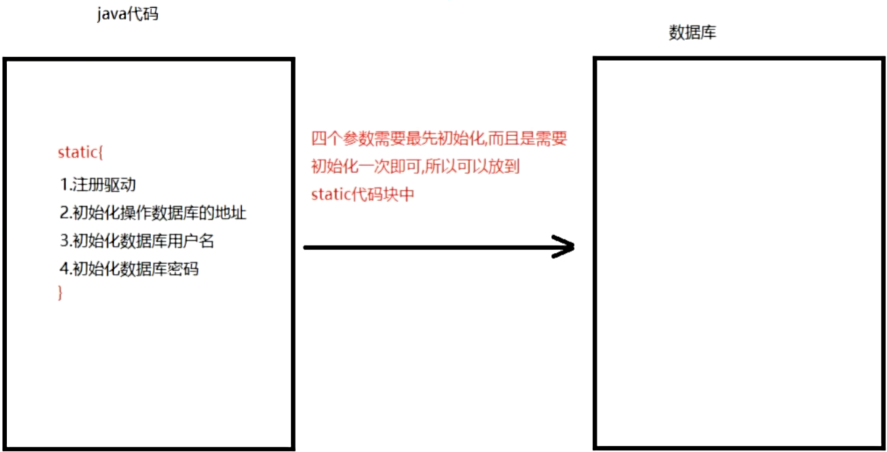

# 1 权限修饰符和静态代码块

## 1.1 权限修饰符

| 位置           | `public` | `protected` | `default`（空的） | `private` |
| -------------- | -------- | ----------- | ----------------- | --------- |
| 同类           | Yes      | Yes         | Yes               | Yes       |
| 同包不同类     | Yes      | Yes         | Yes               | No        |
| 不同包子父类   | Yes      | Yes         | No                | No        |
| 不同包非子父类 | Yes      | No          | No                | No        |

`public` 具有最大权限，`private` 有最小权限。

实际开发时，没有特殊的考虑，建议按如下这样使用权限修饰符：

1. 成员变量：用 `private`（封装思想）
2. 成员方法：用 `public`（便于调用）
3. 构造方法：用 `public`（便于 new 对象）

### 1.1.1 同类

**public、protected、default 和 private** 修饰的成员，在同个类中都能访问

```java
package com.testing.chapter10.accessModifiers;

public class SameCls {
    public String name1 = "test";
    protected String name2 = "test";
    public String name3 = "test";
    private String name4 = "test";

    public void fn() {
        System.out.println(name1);
        System.out.println(name2);
        System.out.println(name3);
        System.out.println(name4);
    }
}
```

### 1.1.1 同包不同类

对于同包的不同类，只能访问 **public、protected 和 default** 修饰的成员，**private** 成员无法在其他类中访问。

```java
package com.testing.chapter10.accessModifiers;

public class SameCls {
    public String name1 = "test";
    protected String name2 = "test";
    public String name3 = "test";
    private String name4 = "test";
}
```

```java
package com.testing.chapter10.accessModifiers;

public class DemoTest01 {
    public static void main(String[] args) {
        SameCls sCls = new SameCls();
        System.out.println(sCls.name1);
        System.out.println(sCls.name2);
        System.out.println(sCls.name3);
        // 'name4' 在 'com.testing.chapter10.accessModifiers.SameCls' 中具有 private 访问权限
        //  System.out.println(sCls.name4);
    }
}
```

### 1.1.1 不同包子父类

不同包的子父类，只能访问 **public、protected** 修饰的成员，**default 和 private** 成员无法在子类中访问。

```java
package com.testing.chapter10.accessModifiers.childPackage1;

public class Parent {
    public String name1 = "test";
    protected String name2 = "test";
    String name3 = "test";
    private String name4 = "test";
}
```

```java
package com.testing.chapter10.accessModifiers.childPackage2;

import com.testing.chapter10.accessModifiers.childPackage1.Parent;

public class DiffChildCls extends Parent {
    public void fn (){
        System.out.println(super.name1);
        System.out.println(super.name2);
        // 'name3' 在 'com.testing.chapter10.accessModifiers.childPackage1.Parent' 中不为 public。无法从外部软件包访问
        // System.out.println(super.name3);
    }
}
```

### 1.1.1 不同包非子父类

不同包的非子父类，只能访问 **public** 修饰的成员，**protected、default 和 private** 成员无法在子类中访问。

```java
package com.testing.chapter10.accessModifiers.childPackage1;

public class Parent {
    public String name1 = "test";
    protected String name2 = "test";
    String name3 = "test";
    private String name4 = "test";
}
```

```java
package com.testing.chapter10.accessModifiers.childPackage2;

import com.testing.chapter10.accessModifiers.childPackage1.Parent;

public class DiffNotChildCls {
    public void fn(){
        Parent p = new Parent();
        System.out.println(p.name1);
        // 'name2' 在 'com.testing.chapter10.accessModifiers.childPackage1.Parent' 中具有 protected 访问权限
        // System.out.println(p.name2);
        // 'name3' 在 'com.testing.chapter10.accessModifiers.childPackage1.Parent' 中不为 public。无法从外部软件包访问
        // System.out.println(p.name3);
        // 'name4' 在 'com.testing.chapter10.accessModifiers.childPackage1.Parent' 中具有 private 访问权限
        // System.out.println(p.name4);
    }
}
```

## 1.2 final 关键字

`final` 翻译过来就是最终的，该关键字可以修饰：类、成员变量、局部变量、成员方法和引用变量

### 1.2.1 修饰类

**格式：**

```java
public final class 类名 { }
```

**特点：**被 `final` 修饰的类不能被继承。

```java
package com.testing.chapter10.finalKeyword.DemoTest01;

public final class Animal { }
```

```java
package com.testing.chapter10.finalKeyword.DemoTest01;

// 报错：无法继承自 final 类 'com.testing.chapter10.finalKeyword.DemoTest01.Animal'
public class Cow extends Animal { }
```

### 1.2.2 修饰成员变量

**格式：**

```java
final 数据类型 变量名 = 值
```

**特点：**被 `final` 修饰的成员变量不能被二次赋值，且初始化后就得手动赋值。

```java
package com.testing.chapter10.finalKeyword.DemoTest05;

public class Man {
    // 报错：字段 'name' 可能尚未初始化
    // final String name;

    final String name = "哈哈"; // 必须要手动赋值

    public void fn (){
        // 报错：无法将值赋给 final 变量 'name'
        // this.name = "嘻嘻";
    }
}
```

### 1.2.3 修饰局部变量

**格式：**

```java
final 数据类型 变量名 = 值

final 数据类型 变量名
变量名 = 值
```

**特点：**被 `final` 修饰的局部变量不能被二次赋值。

```java
package com.testing.chapter10.finalKeyword.DemoTest03;

public class DemoTest03 {
    public static void main(String[] args) {
        final int num1 = 10;
        // num1 = 100; // 报错：无法将值赋给 final 变量 'num'

        final int num2;
        num2 = 20; // 第一次赋值
        // num2 = 200; // 报错：可能已分配变量 num2
    }
}
```

### 1.2.4 修饰成员方法

**格式：**

```java
修饰符 final 返回值类型 方法名(形参) {
    方法体;
    return 返回值;
}
```

**特点：**被 `final` 修饰的成员方法不能被重写。

```java
package com.testing.chapter10.finalKeyword.DemoTest02;

public class Animal {
    public final void fn() { }
}
```

```java
package com.testing.chapter10.finalKeyword.DemoTest02;

public class Cat extends Animal {
    // 报错：'fn()' 无法重写 'com.testing.chapter10.finalKeyword.DemoTest02.Animal' 中的 'fn()'；被重写的方法为 final
    public void fn() { };
}
```

**注意：** `final` 不能和 `abstract` 修饰同个方法。

```java
package com.testing.chapter10.finalKeyword.DemoTest02;

public abstract class Animal {
    // 报错：非法的修饰符组合 'final' 和 'abstract'
    public abstract final void fn1() { }
}
```

### 1.2.5 修饰引用变量

**格式：**

```java
final 数据类型 对象名 = new 类名();
```

**特点：**被 `final` 修饰的引用变量，地址值不能改变，但对象中的属性可以改变。

```java
package com.testing.chapter10.finalKeyword.DemoTest04;

public class Person {
    private String name = "张三";

    public void setName(String name) {
        this.name = name;
    }

    public String getName() {
        return this.name;
    }
}
```

```java
package com.testing.chapter10.finalKeyword.DemoTest04;

public class DemoTest04 {
    public static void main(String[] args) {
        final Person p1 = new Person();
        // p1 = new Person(); // 报错：无法将值赋给 final 变量 'p1'

        // 引用变量的地址值不能改，但是对象中的属性可以改
        System.out.println("修改 name 之前：" + p1.getName());
        p1.setName("李四");
        System.out.println("修改 name 之后：" + p1.getName());
    }
}

/*
修改 name 之前：张三
修改 name 之后：李四
*/
```

## 1.3 代码块

### 1.3.1 构造代码块

**格式：**

```java
public class 类名 {
    {
        // 构造代码块
    }
}
```

**特点：**优先于构造方法执行，每 `new` 一次都会执行一次（属于对象级）。

```java
package com.testing.chapter10.codeBlock;

public class ConstructCodeBlock {
    public ConstructCodeBlock() {
        System.out.println("构造函数");
    }

    {
        System.out.println("构造代码块");
    }
}
```

```java
package com.testing.chapter10.codeBlock;

public class DemoTest01 {
    public static void main(String[] args) {
        ConstructCodeBlock ccb1 = new ConstructCodeBlock();
        ConstructCodeBlock ccb2 = new ConstructCodeBlock();
        // 每 new 一次，构造代码块都会执行一次
    }
}

/*
构造代码块
构造函数
构造代码块
构造函数
*/
```

### 1.3.2 静态代码块

**格式：**

```java
public class 类名 {
    static {
        // 静态代码块
    }
}
```

**特点：**优先于构造代码块和构造方法执行，在类初始化（new 对象、类名.成员属性/方法、子类初始化）阶段执行，且整个类生命周期只执行一次。

```java
package com.testing.chapter10.codeBlock;

public class StaticCodeBlock {
    public StaticCodeBlock() {
        System.out.println("构造函数");
    }

    {
        System.out.println("构造代码块");
    }

    static {
        System.out.println("静态代码块");
    }
}
```

```java
package com.testing.chapter10.codeBlock;

public class DemoTest02 {
    public static void main(String[] args) {
        StaticCodeBlock ccb1 = new StaticCodeBlock();
        StaticCodeBlock ccb2 = new StaticCodeBlock();
        // 静态代码块只在类初始化时执行一次，比如：第一次 new/类名使用成员属性或调用成员方法/子类初始化 的时候
    }
}

/*
静态代码块
构造代码块
构造函数
构造代码块
构造函数
*/
```

#### 静态代码块的应用



# 2 内部类

什么时候需要内部类？

当事物的内部，还有一个结构需要去完整描述时，这个结构就可以使用内部类。

比如：人本身需要属性和行为去描述，那么人可以定义成一个类（外部类），当人的心脏也需要属性和行为去描述的时候，那心脏也可以定义为人内部的一个类（内部类）。

在 java 中，允许一个类定义在另外一个类的内部，前者称为 **内部类**，后者称为 **外部类**。

```java
class A {
    class B {}
}

// A 是外部类，B 是内部类
```

内部类分为这几类：

- 静态成员内部类
- 非静态成员内部类
- 局部内部类
- 匿名内部类

## 2.1 静态成员内部类

**格式：**

```java
public class A {
    static class B {}
}

A.B b = new A.B()
```

**注意：**

- 静态内部类可以被四种修饰符修饰（`public`、`protected`、`默认（不写）`、`private`）

  ```java
  package com.testing.chapter10.innerClass.TestDemo01;

  public class StaticClass01 {
      public static class InnerStaticClass01 {
          public InnerStaticClass01(){
              System.out.println("内部 public 类 InnerStaticClass01");
          }
      }

      protected static class InnerStaticClass02 {
          public InnerStaticClass02(){
              System.out.println("内部 protected 类 InnerStaticClass02");
          }
      }

      static class InnerStaticClass03 {
          public InnerStaticClass03(){
              System.out.println("内部默认类 InnerStaticClass03");
          }
      }

      private static class InnerStaticClass04 {
          public InnerStaticClass04(){
              System.out.println("内部 private 类 InnerStaticClass04");
          }
      }
  }
  ```

  ```java
  package com.testing.chapter10.innerClass.TestDemo01;

  public class TestDemo01 {
      public static void main(String[] args) {
          StaticClass01.InnerStaticClass01 innerStaticClass01 = new StaticClass01.InnerStaticClass01();
          StaticClass01.InnerStaticClass02 innerStaticClass02 = new StaticClass01.InnerStaticClass02();
          StaticClass01.InnerStaticClass03 innerStaticClass03 = new StaticClass01.InnerStaticClass03();
          // 报错：'InnerStaticClass04' 在 'StaticClass01' 中具有 private 访问权限
          // StaticClass01.InnerStaticClass04 innerStaticClass04 = new StaticClass01.InnerStaticClass04();
      }
  }

  /*
  内部 public 类 InnerStaticClass01
  内部 protected 类 InnerStaticClass02
  内部默认类 InnerStaticClass03
  */
  ```

- 静态内部类能被 `final` 和 `abstract` 修饰，被 `final` 修饰后不能被继承，被 `abstract` 修饰后不能被 `new`

  ```java
  package com.testing.chapter10.innerClass.TestDemo02;

  public class StaticClass02 {
      public static final class InnerStaticClass01 {
          public InnerStaticClass01(){
              System.out.println("内部 final 类 InnerStaticClass01");
          }
      }

      protected static abstract class InnerStaticClass02 {
          public InnerStaticClass02(){
              System.out.println("内部 abstract 类 InnerStaticClass02");
          }
      }

      // 报错：无法继承自 final 类 'InnerStaticClass03'
      // class InnerStaticClass03 extends InnerStaticClass01 {}
  }
  ```

  ```java
  package com.testing.chapter10.innerClass.TestDemo02;

  public class TestDemo02 {
      public static void main(String[] args) {
          StaticClass02.InnerStaticClass01 innerStaticClass01  = new StaticClass02.InnerStaticClass01();
          // 报错：'InnerStaticClass02' 为抽象；无法实例化
          // StaticClass02.InnerStaticClass02 innerStaticClass02  = new StaticClass02.InnerStaticClass02();
      }
  }

  /*
  内部 final 类 InnerStaticClass01
  */
  ```

- 静态内部类可以定义：属性、方法和构造

  ```java
  package com.testing.chapter10.innerClass.TestDemo03;

  public class StaticClass03 {
      public static class InnerStaticClass01 {
          String name = "内部类 InnerStaticClass01 的 name 属性";

          public void fn() {
              System.out.println("内部类 InnerStaticClass01 的 fn 方法");
          }

          public InnerStaticClass01() {
              System.out.println("内部类 InnerStaticClass01 的构造函数");
          }
      }
  }
  ```

  ```java
  package com.testing.chapter10.innerClass.TestDemo03;

  public class TestDemo03 {
      public static void main(String[] args) {
          StaticClass03.InnerStaticClass01 innerStaticClass01 = new StaticClass03.InnerStaticClass01();
          System.out.println(innerStaticClass01.name);
          innerStaticClass01.fn();
      }
  }

  /*
  内部类 InnerStaticClass01 的构造函数
  内部类 InnerStaticClass01 的 name 属性
  内部类 InnerStaticClass01 的 fn 方法
  */
  ```

- 静态内部类内部不能调用外部类的非静态成员

```java
package com.testing.chapter10.innerClass.TestDemo04;

public class StaticClass04 {
    String outerId = "外部类 StaticClass04 的属性";

    public void fn() {
        System.out.println("外部类 StaticClass04 的方法");
    }

    public static class InnerStaticClass01 {
        public InnerStaticClass01() {
            // 报错：无法从 static 上下文引用非 static 字段 'outerId'
            // System.out.println(outerId);
            // 报错：无法从 static 上下文引用非 static 方法 'fn()'
            // fn();
        }
    }
}
```

## 2.2 非静态成员内部类

**格式：**

```java
public class A {
    class B {}
}

A.B b = new A().new B()
```

**注意：**

- 静态成员内部类的第 1 ~ 3 注意点同样适用非静态成员内部类
- 非静态成员内部类可以调用外部类所有的成员，包括：外部类的私有、静态和非静态成员。

  ```java
  package com.testing.chapter10.innerClass.TestDemo05;

  public class StaticClass05 {
      String outerId = "外部类 StaticClass05 的属性";
      private String id = "外部类 StaticClass05 的私有属性";

      public void fn1() {
          System.out.println("外部类 StaticClass05 的 fn1 方法");
      }

      private void fn2() {
          System.out.println("外部类 StaticClass05 的 private fn2 方法");
      }

      public class InnerStaticClass01 {
          public InnerStaticClass01() {
              System.out.println(outerId);
              System.out.println(id);
              fn1();
              fn2();
          }
      }
  }
  ```

  ```java
  package com.testing.chapter10.innerClass.TestDemo05;

  public class TestDemo05 {
      public static void main(String[] args) {
          StaticClass05.InnerStaticClass01 innerStaticClass01 = new StaticClass05().new InnerStaticClass01();
      }
  }

  /*
  外部类 StaticClass05 的属性
  外部类 StaticClass05 的私有属性
  外部类 StaticClass05 的 fn1 方法
  外部类 StaticClass05 的 private fn2 方法
  */
  ```

## 2.3 局部内部类

局部内部类可以定义在 `方法`、`代码块` 和 `构造` 中。

```java
package com.testing.chapter10.innerClass.TestDemo07;

public class Person {
    public void fn() {
        class Heart {
            public void heartbeat() {
                System.out.println("心跳声");
            }
        }

        new Heart().heartbeat();
    }
}
```

```java
package com.testing.chapter10.innerClass.TestDemo07;

public class TestDemo07 {
    public static void main(String[] args) {
        Person p = new Person();
        p.fn();
    }
}
```

### 2.3.1 接口类型作为方法参数传递和返回


### 2.3.2

## 2.4 匿名内部类

## 2.5 内、外部类重名变量区分

当内部类方法参数名、内部类属性名、外部类属性名相同时，三者可通过如下方式区分使用：

```java
// 相同的内部类方法参数名，根据就近原则，直接用参数名
name

// 相同的内部类属性名，通过 this 使用，this 代表内部类实例化后的当前实例对象
this.name

// 相同的外部类属性名，通过 外部类.this 使用，外部类.this 代表外部类实例化后的当前实例对象
外部类.this.name
```

```java
package com.testing.chapter10.innerClass.TestDemo06;

public class Student {
    String name = "学生 A";

    class Heart {
        String name = "Heart A";

        public void fn (String name){
            System.out.println("fn 方法的 name 参数：" + name);
            System.out.println("内部类 Heart 的 name 属性：" + this.name);
            System.out.println("外部类 Student 的 name 属性：" + Student.this.name);
        }
    }
}
```

```java
package com.testing.chapter10.innerClass.TestDemo06;

public class TestDemo06 {
    public static void main(String[] args) {
        Student.Heart studentHeart = new Student().new Heart();
        studentHeart.fn("动漫");
    }
}

/*
fn 方法的 name 参数：动漫
内部类 Heart 的 name 属性：Heart A
外部类 Student 的 name 属性：学生 A
*/
```

## 2.6 

## 2.7 
