# 1 类和对象

## 1.1 面向对象的介绍

### 1.1.1 面向过程

是一种以 **过程** 或 **函数** 为中心的编程范式，它强调的是 **解决问题的步骤**。程序被分解为一系列函数或过程的集合，每个函数负责完成一个特定的任务，数据和操作数据的函数是分离的。面向过程编程的核心在于 **如何通过一系列步骤来达到目标**。

**类比：** 像做菜，按照菜谱一步步操作，每个步骤是独立的（切菜、炒菜、调味），但需要自己管理材料和工具。

**适用场景：** 适合解决简单、线性流程的问题，代码结构清晰，但扩展性和复用性较差。

**示例：** 实现计算器程序，下面是面向过程的代码。

```python
def add(a, b):
    return a + b

def subtract(a, b):
    return a - b

def multiply(a, b):
    return a * b

def divide(a, b):
    if b == 0:
        raise ValueError("Division by zero")
    return a / b

# 使用函数
result = add(5, 3)
print(result)  # 输出 8
```

### 1.1.2 面向对象

面向对象是一种以 **对象** 为中心的编程范式，它强调的是 **数据和操作数据的方法的封装**。程序被组织为一系列对象的集合，每个对象包含数据（属性）和操作这些数据的方法（行为）。面向对象编程的核心在于 **如何通过对象之间的交互来解决问题**。

**类比：** 像点外卖，你只需要告诉商家（对象）你要什么菜，商家会处理所有细节（切菜、炒菜、调味），你只需要等待结果。

**适用场景：** 适合解决复杂问题，通过封装、继承和多态等特性提高代码的复用性和扩展性，更符合人类的思维方式。

**示例：** 实现计算器程序，下面是面向对象的代码。

```python
class Calculator:
    def add(self, a, b):
        return a + b

    def subtract(self, a, b):
        return a - b

    def multiply(self, a, b):
        return a * b

    def divide(self, a, b):
        if b == 0:
            raise ValueError("Division by zero")
        return a / b

# 使用对象
calc = Calculator()
result = calc.add(5, 3)
print(result)  # 输出 8
```

## 1.2 类和对象的介绍

### 1.2.1 类

之前我们学习接触到的类，主要是**测试类（带 main 方法的类）**，其主要是用来运行代码。

接下来学习的是 **实体类**，它主要是一类事物的抽象表示形式，比如：人类、动物类、手机类等。下面会举例说明。

#### 类的组成部分

类的组成部分主要分为两种：**属性（成员变量）** 和 **行为（成员方法）**

- **属性（成员变量）**，用于描述类对象的状态的数据
  - 定义位置：定义在类中的方法外面
  - 作用范围：作用于当前类
  - 定义格式：`数据类型 变量名`
  - 定义的时候，可以不用初始化赋值，会有默认值：
    - 整数：0
    - 小数：0.0
    - 字符：`'\u0000'`
    - 布尔：`false`
    - 引用：`null`
- **行为（成员方法）**，用于描述对象可以执行的操作或功能。

#### 示例

以下几个类都属于同个包：`package com.testing.oop.Demo01;`。

```java
public class Person {
    String name;
    int age;

    public void eat() {
        System.out.println("干饭");
    }

    public void drink() {
        System.out.println("喝饮料");
    }
}
```

```java
public class Phone {
    String brand;

    public void call(){
        System.out.println("打电话");
    }
}
```

```java
public class Animal {
    String kind;
    int num;

    public void statistics(){
        System.out.println("统计动物数量：" + num);
    }
}
```

```java
public class Demo01 {
    public static void main(String[] args) {
        Person person = new Person();
        person.eat();
        Phone phone = new Phone();
        phone.call();
        Animal animal = new Animal();
        animal.num = 100;
        animal.statistics();
    }
}
```

**注意：** 在同个包下的类可以直接使用，而无需导包。

### 1.2.2 对象

概述：一类事物的具体体现。

使用：

- 导包：`import 包名.类名`；
- 创建对象，想要使用哪个类中的成员，就 new 哪个类
- 调用成员（成员变量、成员方法），通过 new 出来的对象就可以使用构造出该对象的类里面变量和方法。

```java
package com.testing.oop.Demo02;

public class Phone {
    String brand;
    String color;
    int price;

    public void call(String name) {
        String callStr1 = "用价格为" + price + "的" + color + brand;
        String callStr2 = "给" + name + "打电话";
        System.out.println(callStr1 + callStr2);
    }

    public String message(String name) {
        return "给" + name + "发短信";
    }
}
```

```java
package com.testing.oop.Demo02;

public class Demo02 {
    public static void main(String[] args) {
        Phone phone = new Phone();
        phone.brand = "HUAWEI";
        phone.color = "黑色";
        phone.price = 5220;

        phone.call("王思聪");
        String sms = phone.message("柳岩");
        System.out.println(sms);
    }
}

/*
用价格为5220的黑色HUAWEI给王思聪打电话
给柳岩发短信
*/
```

## 1.3 匿名对象的使用

匿名对象是指创建对象（new 一个对象）时，不将对象赋值给任何变量，而直接使用对象。

匿名对象的使用时机：当只需要调用一个对象的方法，且不涉及变量的赋值时，可以使用匿名对象。

```java
package com.testing.oop.Demo03;

public class Person {
    String name = "";

    public void eat() {
        if (name.isEmpty()) {
            System.out.println("人要吃饭！");
        } else {
            System.out.println(name + "要吃饭！");
        }
    }
}
```

```java
package com.testing.oop.Demo03;

public class Demo03 {
    public static void main(String[] args) {
        Person person = new Person();
        person.name = "姚明";
        person.eat();

        new Person().eat();
    }
}

/*
姚明要吃饭！
人要吃饭！
*/
```

## 1.4 对象的内存图

### 1.4.1 一个对象的内存图

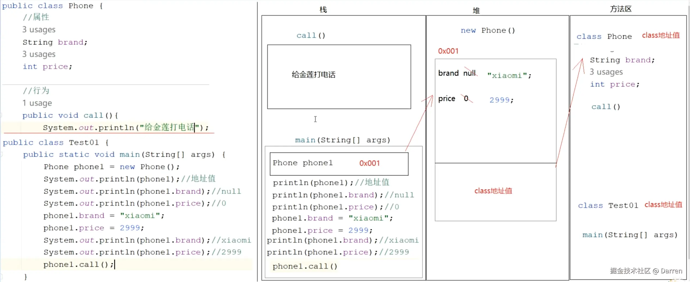

### 1.4.2 两个对象的内存图

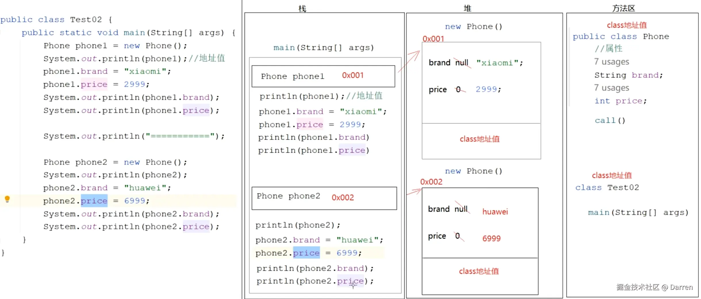

同个 `class` new 出来两个不同的对象，在内存堆中是各自管理自己的成员变量的，彼此之间互不影响。

### 1.4.3 两个对象指向同一片堆空间的内存图

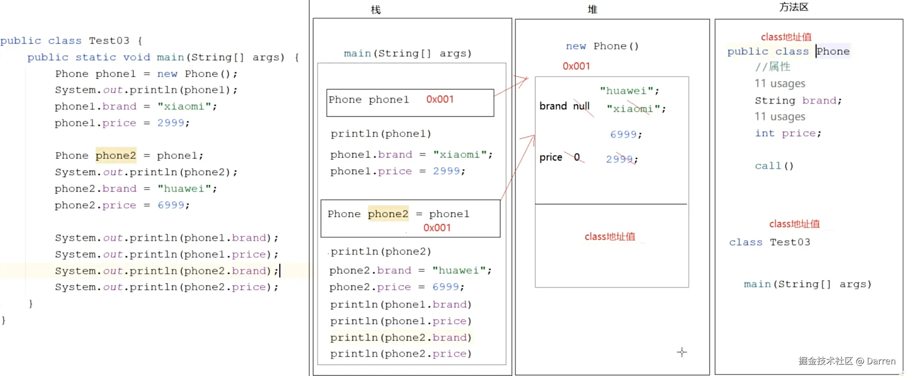

两个变量指向同个实例对象，当改变其中一个变量（存储着对象地址）的某个成员变量时，另外一个变量（存储着同个对象地址）也会被同步修改。

## 1.5 成员变量和局部变量的区别

**示例代码：**

```java
public class Person {
    // 成员变量定义在类内，方法的外面，作用于当前类
    String name; // 没有初始化赋值，引用类型默认是 null
    int age; // 没有初始化赋值，int 类型默认是 0

    public void eat() {
        // 局部变量定义方法的代码块内，作用于当前代码块
        // String food;
        // System.out.println(food); // 未初始化赋值就使用 food，会报错："变量 'food' 可能尚未初始化"
        System.out.println("干饭");
    }

    public void drink(String thing) {
        // 或者局部变量定义在方法的参数上，作用于当前代码块
        System.out.println("喝饮料" + thing);
    }
}
```

**主要有以下区别：**

| 序号 | 区别点   | 成员变量                                   | 局部变量                                           |
| ---- | -------- | ------------------------------------------ | -------------------------------------------------- |
| 1    | 定义位置 | 定义在类中方法的外面                       | 定义在方法体内，或者方法参数中                     |
| 2    | 初始化值 | 初始化后有默认值，不用手动赋值也可直接使用 | 初始化后没有默认值，必须手动赋值才能使用，否则报错 |
| 3    | 作用范围 | 作用于整个 `class` 中                      | 作用于当前方法体内其所在的代码块                   |
| 4    | 生命周期 | 随着对象的创建而产生，消失而消失           | 随着方法的调用而产生，调用完毕而消失               |
| 5    | 内存位置 | 在内存堆中，跟着实例对象位置走             | 在内存栈中，跟着方法走                             |

## 1.6 练习

定义一个 MyDate 类，要求成员变量有：year、month、day，再定义一个 Citizen 类，要求成员变量有：name、birthday、idCard，为这三个成员变量赋值，并取值打印。

```java
package com.testing.oop.Demo04;

public class MyDate {
    String year;
    String month;
    String day;
}
```

```java
package com.testing.oop.Demo04;

public class Citizen {
    String name;
    MyDate birthday = new MyDate();
    String idCard;
}
```

```java
package com.testing.oop.Demo04;

public class Demo04 {
    public static void main(String[] args) {
        Citizen citizen = new Citizen();
        citizen.name = "江哥";
        citizen.birthday.year = "2025";
        citizen.birthday.month = "07";
        citizen.birthday.day = "07";
        citizen.idCard = "auth123";

        System.out.println(citizen.name + "_" + citizen.birthday.year + citizen.birthday.month + citizen.birthday.day + "_" + citizen.idCard);
    }
}

/*
江哥_20250707_auth123
*/
```

# 2 封装

封装的本质是 **信息隐藏** 和 **接口暴露**。通过将对象的内部状态（属性）和行为（方法）绑定成一个整体，并对外部隐藏实现细节，仅通过公共接口与外界交互。

这种设计模式有利于：

- **保护数据安全**：防止外部直接修改对象的内部状态（如通过 `private` 修饰属性）
- **降低耦合度**：外部代码只需依赖接口，无需关心内部实现，从而提高代码的可维护性和扩展性
- **模块化设计**：将功能封装为独立的单元，便于复用和测试

样例 1：

java 内部封装的类

```java
package com.testing.oop.Demo05;

import java.util.Arrays;

public class Demo05Test01 {
    public static void main(String[] args) {
        int[] arr = {1, 2, 3, 4};

        // 这里的 toString 就是一个封装好的功能，通过外界的参数来与其进行交互
        System.out.println(Arrays.toString(arr));
    }
}

/*
[1, 2, 3, 4]
*/
```

样例 2：

把一些功能封装到函数里面，也是封装

```java
package com.testing.oop.Demo05;

public class Demo05Test02 {
    public static void main(String[] args) {
        int[] arr = {11, 22, 33, 44};
        String res = customToString(arr);
        System.out.println(res);
    }

    // 封装自定义 toString 功能
    public static String customToString(int[] arr) {
        StringBuilder sb = new StringBuilder();
        sb.append("[");
        for (int i = 0; i < arr.length; i++) {
            if (i > 0) {
                sb.append(',');
            }
            sb.append(arr[i]);
        }
        sb.append("]");

        return sb.toString();
    }
}

/*
[11,22,33,44]
*/
```

样例 3：

定义一个类的私有属性（private），并暴露对应的获取和设置接口，也是封装，private 的属性，在类外是无法被访问的，只能在类内访问，如果要访问和改变 private 属性，需要通过暴露的 get/set 接口来访问操作。

```java
package com.testing.oop.Demo05;

public class Person {
    private String name;
    private int age;

    public String getName() {
        return this.name;
    }

    public int getAge() {
        return this.age;
    }

    public void setName(String name) {
        this.name = name;
    }

    public void setAge(int age) {
        if (age < 0 || age > 150) {
            System.out.println("您是神仙！");
        } else {
            this.age = age;
        }
    }
}
```

```java
package com.testing.oop.Demo05;

public class Demo05Test03 {
    public static void main(String[] args) {
        Person p = new Person();
        // p.name  // 因为 name 是 private，会提示：'name' 在 'com.testing.oop.Demo05.Person' 中具有 private 访问权限
        // p.age  // 因为 age 是 private，会提示：'age' 在 'com.testing.oop.Demo05.Person' 中具有 private 访问权限
        System.out.println("没有 set name & age 之前，Name==" + p.getName() + "，Age==" + p.getAge() );
        p.setName("鸣人");
        p.setAge(20);
        System.out.println("set name & age 之后，Name==" + p.getName() + "，Age==" + p.getAge() );
    }
}

/*
没有 set name & age 之前，Name==null，Age==0
set name & age 之后，Name==鸣人，Age==20
*/
```

## 2.1 关于 `class` 中的 `this`

在类中，`this` 指向 new 出的当前对象。例如：new 出来的一个对象，调用这个对象中的某个方法，方法中 `this` 的指向就是这个对象。

```java
package com.testing.oop.Demo05;

public class Person {
    public void findThis(String indicator) {
        System.out.println(indicator + ": " + this);
    }
}
```

```java
package com.testing.oop.Demo05;

public class Demo05Test04 {
    public static void main(String[] args) {
        Person p1 = new Person();
        System.out.println("对象p1：" + p1);
        p1.findThis("p1"); // this 指向当前对象的地址值

        Person p2 = new Person();
        System.out.println("对象p2：" + p2);
        p2.findThis("p2"); // this 指向当前对象的地址值
    }
}

/*
对象1：com.testing.oop.Demo05.Person@23fc625e
p1: com.testing.oop.Demo05.Person@23fc625e
对象2：com.testing.oop.Demo05.Person@3a71f4dd
p2: com.testing.oop.Demo05.Person@3a71f4dd
*/
```

当成员变量和局部变量重名时，通过 `this` 能清楚区分二者。

```java
public class Person {
    private String name;

    public void setName(String name) {
        this.name = name;
        // name = name  // 如果不使用 this，就是 setName 这个函数的局部变量 name 给自己赋值了一次
    }
}
```

## 2.2 class 的构造方法

`构造方法` 就是方法名和类名一致，并能初始化对象状态的方法。其特点是：

- 方法名和类名一致；
- 方法不用写返回值类型；
- 可以有参数，也可以无参数；
- 在 `new` 对象的时候自动创建和调用

主要作用，可以初始化对象的状态，给成员变量赋值。

`构造方法` 主要分为两种，`无参构造` 和 `有参构造`。

**注意：**当你不提供构造函数的时候，`jvm` 会自动为类加上无参构造函数（只会提供无参构造函数）。但当你加上有参构造函数后，`jvm` 将不再提供无参构造函数，需要你自己添加无参构造重载函数。建议定义有参构造函数的同时也加上无参构造函数。

### 2.1 无参构造

格式：

```java
public 类名() {}
```

示例：

```java
package com.testing.oop.Demo06;

public class Man {
    public Man() {
        // new 对象的时候，这里的代码会自动调用
        System.out.println("Man的无参构造函数！");
    }
}
```

```java
package com.testing.oop.Demo06;

public class Demo06 {
    public static void main() {
        Man m = new Man();
    }
}

/*
Man的无参构造函数！
*/
```

### 2.2 有参构造

格式：

```java
public 类名(形参, ...) {
    为属性（成员变量）赋值
}
```

示例：

```java
package com.testing.oop.Demo07;

public class Human {
    String name;
    int age;

    public Human() {
        System.out.println("Human的有参构造函数-重载函数1-无参");
    }

    public Human(String name) {
        this.name = name;
        System.out.println("Human的有参构造函数-重载函数2-有 name 参数");
    }

    public Human(int age) {
        this.age = age;
        System.out.println("Human的有参构造函数-重载函数3-有 age 参数");
    }

    public Human(String name, int age) {
        this.name = name;
        this.age = age;
        System.out.println("Human的有参构造函数-重载函数4-有 name 和 age 参数");
    }
}
```

```java
package com.testing.oop.Demo07;

public class Demo07 {
    static void main() {
        Human h1 = new Human();
        System.out.println("h1--name：" + h1.name + "，age：" + h1.age);

        Human h2 = new Human("韩立");
        System.out.println("h2--name：" + h2.name + "，age：" + h2.age);

        Human h3 = new Human(280);
        System.out.println("h3--name：" + h3.name + "，age：" + h3.age);

        Human h4 = new Human("韩道友", 280);
        System.out.println("h4--name：" + h4.name + "，age：" + h4.age);
    }
}

/*
Human的有参构造函数-重载函数1-无参
h1--name：null，age：0
Human的有参构造函数-重载函数2-有 name 参数
h2--name：韩立，age：0
Human的有参构造函数-重载函数3-有 age 参数
h3--name：null，age：280
Human的有参构造函数-重载函数4-有 name 和 age 参数
h4--name：韩道友，age：280
*/
```

## 2.3 JavaBean

JavaBean 是 java 语言编写类的一种标准规范。要求：

- 类必须是具体的（非抽象 `abstract`）和公共的（public class 类名）；
- 有无参构造或有参构造；
- 成员变量私有化，并有可以操作成员变量的 `get` 和 `set` 方法

```java
package com.testing.oop.Demo08;

public class Student {
    private String name;
    private int age;


    public Student() {
    }

    public Student(String name) {
        this.name = name;
    }

    public Student(int age) {
        this.age = age;
    }

    public Student(String name, int age) {
        this.name = name;
        this.age = age;
    }

    public String getName() {
        return name;
    }

    public void setName(String name) {
        this.name = name;
    }

    public int getAge() {
        return age;
    }

    public void setAge(int age) {
        this.age = age;
    }
}
```

```java
package com.testing.oop.Demo08;

public class Demo08 {
    static void main() {
        Student s1 = new Student();
        System.out.println("s1--name：" + s1.getName() + "，age：" + s1.getAge());

        Student s2 = new Student();
        s2.setName("韩立");
        System.out.println("s2--name：" + s2.getName() + "，age：" + s2.getAge());

        Student s3 = new Student(280);
        s3.setAge(280);
        System.out.println("s3--name：" + s3.getName() + "，age：" + s3.getAge());

        Student s4 = new Student();
        s4.setName("韩道友");
        s4.setAge(280);
        System.out.println("s4--name：" + s4.getName() + "，age：" + s4.getAge());
    }
}

/*
s1--name：null，age：0
s2--name：韩立，age：0
s3--name：null，age：280
s4--name：韩道友，age：280
*/
```

### JavaBean 快捷键

把光标放在类中，按 `Alt` + `Insert`，可以打开快速生成 JavaBean 各项代码的窗口，如下图：

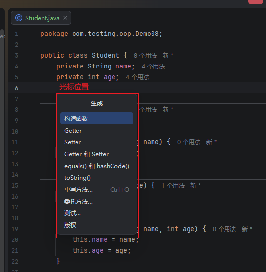

生成构造函数（如下图）：

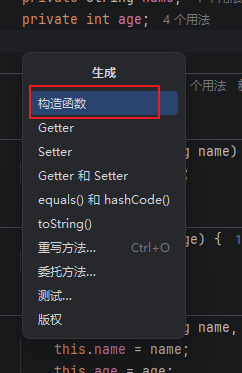

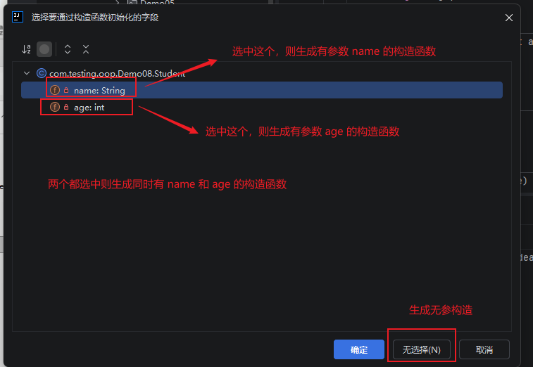

生成 get 和 set 方法（如下图）：

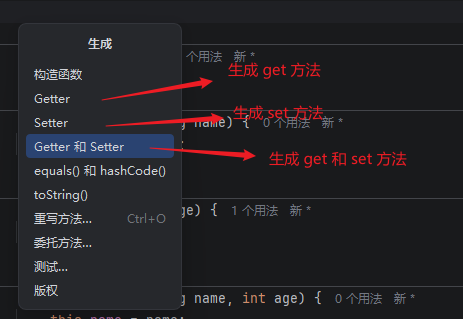

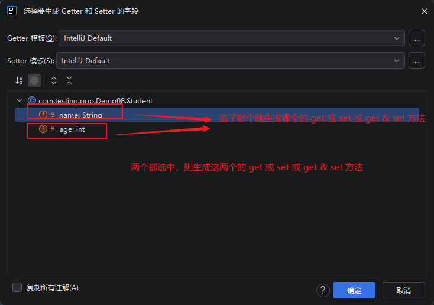

### JavaBean 在实际开发中的分层位置

`com.project.controller`，专门放和页面打交道的类（表现层）。
`com.project.service`，专门放业务处理的类（业务层）。
`com.project.dao`，专门放和数据打交道的类（持久层）。
`com.project.pojo`，专门放 JavaBean 类。
`com.project.utils`，专门放工具类。

### JavaBean 的使用

JavaBean 在实际开发中的使用，基本都和数据库的表相关联：

#### JavaBean 和数据库表的对应关系

- 类名 -> 表名
- 属性名 -> 列名
- 属性值 -> 表中单元格中的数据
- 对象 -> 表中每一行的数据

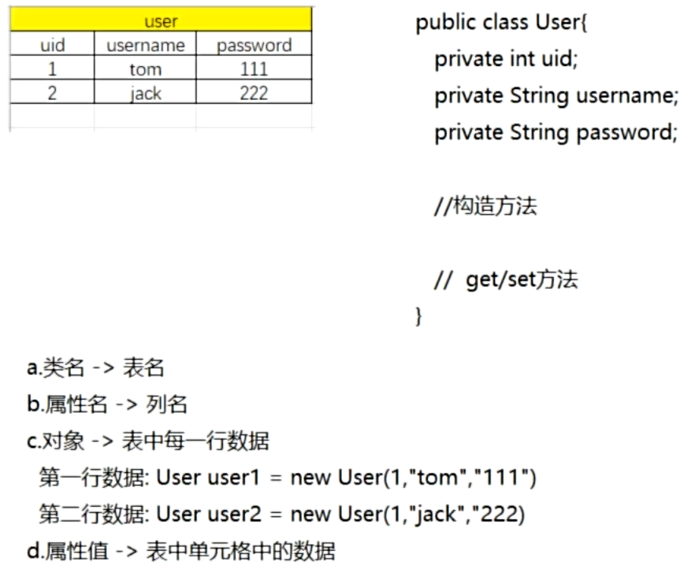

#### JavaBean 参与添加功能

此部分 JavaBean 表现出来的功能（添加）是，获取页面填写的数据，封装到 JavaBean 中，然后一层层传递到 dao 层（持久层），接着将 JavaBean 中的属性值取出来放到表中保存。这个过程就相当于一个**添加功能**。

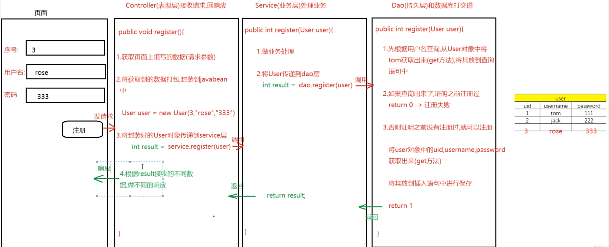

#### JavaBean 参与查询功能

此部分 JavaBean 表现出来的功能（查询）是，将所有的数据查询出来，封装成一个个 JavaBean 对象，然后将封装好的 JavaBean 对象放到一个容器中，再将此容器返回给页面，在页面上遍历展示。

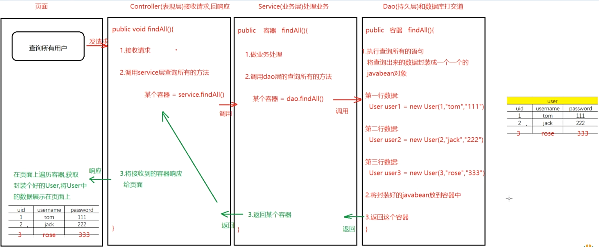

# 3 static 修饰符

`static` 是一个静态修饰符，用于修饰成员变量/方法，表示该成员属于类本身，而不属于某个实例对象，所有对象共享同一份，**可通过类名直接访问**，无需创建对象。

格式如下：

```java
// 修饰成员变量
static 数据类型 变量名

// 修饰成员方法
修饰符 static 返回值类型 方法名(形参) {
    方法体;
    return 结果;
}
```

静态成员的特点：

- 静态成员属于类成员，而不属于对象成员（非静态成员），可通过类名直接访问；
- 静态成员会随着类的加载而加载（类文件和其中信息存于方法区中），所以会优先于非静态成员存在于内存中；
- 基于相同类创建的对象，都可以共享静态成员。

```java
package com.testing.oop.Demo09;

public class Student {
    String name;
    int age;
    static String classRoom;

    public Student(String name, int age) {
        this.name = name;
        this.age = age;
    }
}
```

```java
package com.testing.oop.Demo09;

public class Demo09 {
    static void main() {
        Student.classRoom = "高三冲刺班";

        Student s1 = new Student("小韩", 200);
        System.out.println("第 1 个学生的名字：" + s1.name + "，年龄：" + s1.age + "，班级：" + Student.classRoom);

        Student s2 = new Student("大韩", 350);
        System.out.println("第 2 个学生的名字：" + s2.name + "，年龄：" + s2.age + "，班级：" + Student.classRoom);
    }
}

/*
第 1 个学生的名字：小韩，年龄：200，班级：高三冲刺班
第 2 个学生的名字：大韩，年龄：350，班级：高三冲刺班
*/
```

## 3.1 static 静态关键字内存说明

类在 JDK6 及之前，是全部都放在方法区里面。

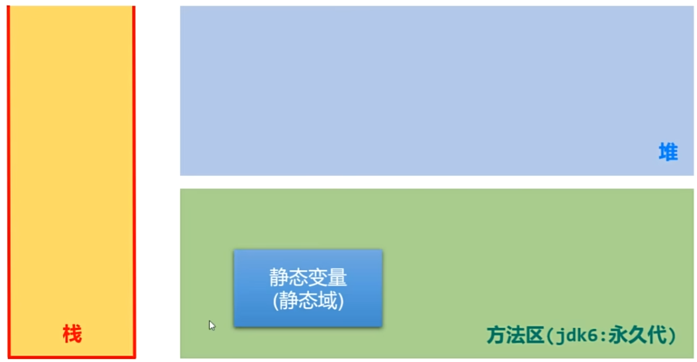

类在 JDK7 以及之后的版本，被拆成两部分存放，类的结构信息存在方法区，类对象则放在堆里面。

这么拆分的原因是：堆对数据的回收效率很高这个特性相对于方法区更适合存放和管理类对象。

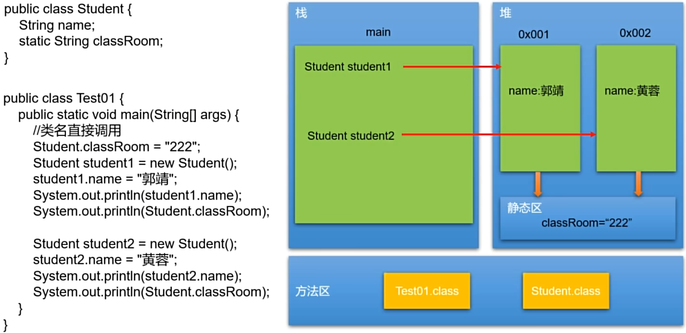

## 3.2 static 修饰成员的访问特点

### 静态方法直接访问非静态成员

不能直接访问。

```java
public class Demo10Test01 {
    static void main() {
        method(); // 报错：无法从 static 上下文引用非 static 方法 'method()'
    }

    // 非静态成员 - method
    public void method() { }
}
```

如果要访问静态成员，需要通过 new 出实例对象来访问。

```java
public class Demo10Test02 {
    static void main() {
        Demo10Test02 d = new Demo10Test02();
        d.method();
    }

    // 非静态成员 - method
    public void method() { }
}
```

### 静态方法直接访问静态成员

可以直接访问。

在同个类中，可以直接调用，也可以类名调用：

```java
public class Demo11Test03 {
    static void staticMethod01() {
        staticMethod02();
        Demo11Test03.staticMethod02();
    }

    static void staticMethod02() {}
}
```

不同类中，只能类名调用：

```java
package com.testing.oop.Demo11;

public class Person {
    static void eat() {}
}
```

```java
package com.testing.oop.Demo11;

public class Demo11Test02 {
    static void staticMethod() {
        Person.eat();
    }
}
```

### 非静态方法直接访问静态成员

可以直接访问。

在同个类中，可以直接调用，也可以类名调用：

```java
public class Demo11Test01 {
    static void staticMethod() {}

    public void instanceMethod() {
        staticMethod(); // 同个类，直接调用。
        Demo11Test01.staticMethod(); // 或类名调用。
    }
}
```

不同类中，只能类名调用：

```java
package com.testing.oop.Demo11;

public class Person {
    static void eat() {}
}
```

```java
package com.testing.oop.Demo11;

public class Demo11Test02 {
    public void instanceMethod() {
        Person.eat();
    }
}
```

### 非静态方法直接访问非静态成员

可以直接访问。

在同个类中，可以直接调用，也可以 new 对象调用：

```java
public class Demo11Test05 {
    public void instanceMethod01() {
        instanceMethod02();
        Demo11Test05 d = new Demo11Test05();
        d.instanceMethod02();
    }

    public void instanceMethod02() {
        Person.eat();
    }
}
```

不同类中，只能类名调用：

```java
package com.testing.oop.Demo11;

public class Person2 {
    public void drink() { }
}
```

```java
package com.testing.oop.Demo11;

public class Demo11Test06 {
    public void instanceMethod() {
        Person2 p = new Person2();
        p.drink();
    }
}
```

**总结：**

- 非静态成员都可以通过 new 对象调用；
- 静态成员可以通过类名调用。

## 3.3 静态成员在开发中的使用场景

**问题1：**static 成员使用起来如此方便（直接类名使用，不用 new 对象），在实际开发中，能否将所有成员都定义成静态呢？

不能。因为静态成员会随着类的加载而加载，如果将所有成员都静态化，类一加载，所有静态成员都会进内存，会大量占用内存。而且有时候需要基于一些参数值来 new 各个不同的对象，从而得到参数名相同，参数值不同的各个对象，如果都是静态成员，那所有对象都是共享同一份数据了，无法实现值的差异化。

**问题2：**那静态成员什么时候定义呢？

一般在抽取工具类的时候会将工具类中的所有成员定义成静态的。

**问题3：**什么时候定义工具类呢？

当发现代码一样，功能一样的时候，就可以把这部分代码功能抽取到工具类中。

封装工具类的时候，构造方法用 `private` 修饰，因为工具类的成员都是静态的，不需要 new 对象。当用`private` 修饰了工具类之后，该类就无法 new 了。

```java
package com.testing.oop.Demo12;

public class ArrayUtils {
    private ArrayUtils() { }

    public static int getMax(int[] arr) {
        int max = 0;
        for (int j : arr) {
            if (j > max) {
                max = j;
            }
        }
        return max;
    }
}
```

```java
package com.testing.oop.Demo12;

public class Demo12 {
    static void main() {
        int[] nums = {4, 6, 834, 62, 11, 6};
        int max = ArrayUtils.getMax(nums);
        // new ArrayUtils(); // 报错：'ArrayUtils()' 在 'com.testing.oop.Demo12.ArrayUtils' 中具有 private 访问权限
        System.out.println("nums中最大的数字是: " + max);
    }
}

/*
nums中最大的数字是: 834
*/
```

# 4 扩展知识

## 4.1 可变参数

当只明确了方法参数的类型，但不明确方法参数个数时，此时就可以将方法的参数定义成可变参数。

定义格式：

```java
public void restMethod(int ...rest) {}
```

**注意：**

- 可变参数的本质是一个数组。
  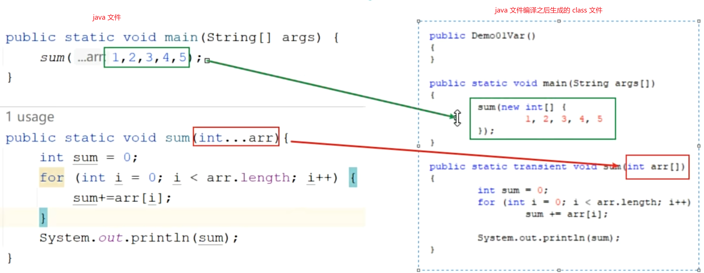

  ```java
  public class Demo01Test {
    static void main() {
        restMethod(1, 2, 3, 4, 5);
    }

    public static void restMethod(int... rest) {
        int sum = 0;
        for (int i : rest) {
            sum += i;
        }
        System.out.println("sum==" + sum);
    }
  }

  /*
  sum==15
  */
  ```

- 方法参数只能写一个可变参数，当可变参数和其他形参一起定义时，可变参数必须要放到最后一个位置

  ```java
  public class Demo02Test {
      static void main() {
          restMethod(200, 1, 2, 3, 4, 5);
      }

      public static void restMethod(int first, int... rest) {
          int sum = 0;
          sum += first;
          for (int i : rest) {
              sum += i;
          }
          System.out.println("sum==" + sum);
      }
  }

  /*
  sum==215
  */
  ```

  ```java
  // 可变参数如果放在其他形参前面，会报错：Vararg 形参必须为列表中的最后一个形参
  public static void restMethod(int... rest, String str) {}
  ```

### 4.1.1 可变参数练习

**需求1：**定义一个方法，返回 n 个字符串拼接结果，如果没有传入字符串，那么返回空字符串 ""。

```java
public class DemoTest04 {
    static void main() {
        String s = composedStr("马大哈", "嘿嘿");
        System.out.println("s==" + s);
    }

    public static String composedStr(String... rest) {
        if (rest.length == 0) {
            return "";
        }
        StringBuilder result = new StringBuilder();
        for (String s : rest) {
            result.append(s);
        }
        return result.toString();
    }
}

/*
s==马大哈嘿嘿
*/
```

**需求2：**定义一个方法，对 n 个字符串进行拼接，每个字符串之间使用某字符进行分隔，如果没有传入字符串，那么返回空字符串 ""。

```java
public class DemoTest05 {
    static void main() {
        String s = composedStr("-", "老韩", "韩老魔", "小韩");
        System.out.println("s==" + s);
    }

    public static String composedStr(String splitStr, String... rest) {
        if (rest.length == 0) {
            return "";
        }
        StringBuilder sb = new StringBuilder();
        for (int i = 0; i < rest.length; i++) {
            sb.append(rest[i]);
            if(i < rest.length - 1) {
                sb.append(splitStr);
            }
        }
        return  sb.toString();
    }
}

/*
s==老韩-韩老魔-小韩
*/
```

## 4.2 递归

递归就是在方法内部自己调用自己。

主要分为 2 类：

- 直接递归

```java
public statis void method() {
    method();
}
```

- 间接递归

```java
public statis void a() {
    b();
}

public statis void b() {
    c();
}

public statis void c() {
    a();
}
```

**注意：**递归必须有出口，否则会报错：“栈内存溢出”。即使有出口，也尽量控制递归的次数不要太多。

```java
public class Demo02RecursionTest01 {
    static void main() {
        method();
    }

    public static void method() {
        method();
    }
}

// 运行之后报错：Exception in thread "main" java.lang.StackOverflowError
```

正确的应该是添加出口条件：

```java
public class Demo02RecursionTest01 {
    static void main() {
        method(1);
    }

    public static void method(int num) {
        System.out.println("num==" + num);
        num = num + 1;
        if (num == 5) {
            return;
        }
        method(num);
    }
}

/*
num==1
num==2
num==3
num==4
*/
```

### 练习

#### 给定一个数字，逐个打印这个数字到 1

```java
public class Demo02RecursionTest02 {
    static void main() {
        method(5);
    }

    public static void method(int num) {
        System.out.println("num==" + num);
        if (num == 1) {
            return;
        }
        num--;
        method(num);
    }
}

/*
num==5
num==4
num==3
num==2
num==1
*/
```

#### 求 n!（n 的阶乘）

```java
public class Demo02RecursionTest03 {
    static void main() {
        int res = method(4);
        System.out.println("res==" + res);
    }

    public static int method(int num) {
        if (num == 1) {
            return num;
        }

        return num * method(num - 1);
    }
}

/*
res==24
*/
```

#### 斐波那契数列

假设一对刚出生的兔子一个月后就能长成大兔，再过一个月就能生下一对小兔，并且此后每个月都生一对小兔，一年内都没有发生死亡。

问：一对刚出生的兔子，一年内能繁殖成多少对兔子？

```java
public class Demo02RecursionTest04 {
    static void main() {
        int res = getNum(12);
        System.out.println("res==" + res);
    }

    public static int getNum(int mounth) {
        if (mounth <= 2) {
            return  1;
        }

        return  getNum(mounth - 1) + getNum(mounth - 2);
    }
}

/*
res==144
*/
```

## 4.3 数字常见算法

### 4.3.1 数组翻转

数组对称索引位置上的元素互换

```java
import java.util.Arrays;

public class Demo03AlgorithmTest01 {
    static void main() {
        int[] oddArr = {1, 2, 3, 4, 5};
        System.out.println("oddArr翻转之前==" + Arrays.toString(oddArr) + "。oddArr翻转之后==" + Arrays.toString(reverseArr(oddArr)));
        int[] evenArr = {1, 2, 3, 4, 5, 6, 7, 8};
        System.out.println("evenArr翻转之前==" + Arrays.toString(evenArr) + "。evenArr翻转之后==" + Arrays.toString(reverseArr(evenArr)));
    }

    public static int[] reverseArr(int[] arr) {
        for (int i = 0; i < arr.length / 2; i++) {
            int temp = arr[i];
            arr[i] = arr[arr.length - 1 - i];
            arr[arr.length - 1 - i] = temp;
        }
        return arr;
    }
}

/*
oddArr翻转之前==[1, 2, 3, 4, 5]。oddArr翻转之后==[5, 4, 3, 2, 1]
evenArr翻转之前==[1, 2, 3, 4, 5, 6, 7, 8]。evenArr翻转之后==[8, 7, 6, 5, 4, 3, 2, 1]
注意：Arrays.toString 打印的是字符串，所以前后结果不同，是因为打印成字符串的时候记录的是当前的数组内容，其实原数组已经被改变。
*/
```

### 4.3.2 数组冒泡排序

冒泡排序是采用数组中相邻元素进行比较换位的排虚方法。

```java
import java.util.Arrays;

public class Demo03AlgorithmTest02 {
    static void main() {
        int[] num = {11, 123, 21, 83, 15, 8};
        System.out.println("冒泡排序之前==" + Arrays.toString(num) + "。冒泡排序之后==" + Arrays.toString(bubbleSort(num)));

    }

    public static int[] bubbleSort(int[] arr) {
        for (int j = 0; j < arr.length - 1; j++) {
            for (int i = 0; i < arr.length - 1 - j; i++) {
                if (arr[i] > arr[i + 1]) {
                    int temp = arr[i];
                    arr[i] = arr[i + 1];
                    arr[i + 1] = temp;
                }
            }
        }

        return arr;
    }
}

/*
冒泡排序之前==[11, 123, 21, 83, 15, 8]。冒泡排序之后==[8, 11, 15, 21, 83, 123]
*/
```

### 4.3.3 二分查找

二分查找是在有序数组中，先根据查找区间的首尾下标算出中间位置，用中间位置的元素与目标值比较，再根据比较结果缩小查找区间，重复这个过程直到找到目标值并返回其下标，或确定目标值不存在。

**注意：**二分查找有个前提，就是数组中的数据必须是有序的。

```java
public class Demo03AlgorithmTest03 {
    static void main() {
        int[] nums = {1, 2, 3, 4, 5, 6};
        int idx = twoFind(nums, 4);
        System.out.println("4的索引是==" + idx);
    }

    public static int twoFind(int[] arr, int key) {
        int min = 0, max = arr.length - 1, mid = 0;
        while (min <= max) {
            mid = (min + max) / 2;
            if (key < arr[mid]) {
                max = mid - 1;
            } else if (key > arr[mid]) {
                min = mid + 1;
            } else {
                return mid;
            }
        }
        return -1;
    }
}

/*
4的索引是==3
*/
```

## 4.4 对象数组

顾名思义，就是在数组中存对象。

### 练习 1

定义一个长度为 3 的数组，存储 3 个 Person 对象，遍历数组并把 Person 对象中的属性值取出来。

```java
package com.testing.oop.expansionKnowledge.Demo04_objArr;

public class Person {
    private String name;
    private int age;

    public Person() { }

    public Person(String name, int age) {
        this.name = name;
        this.age = age;
    }

    public String getName() {
        return name;
    }

    public void setName(String name) {
        this.name = name;
    }

    public int getAge() {
        return age;
    }

    public void setAge(int age) {
        this.age = age;
    }
}
```

```java
package com.testing.oop.expansionKnowledge.Demo04_objArr;

public class Demo04ObjArrTest01 {
    static void main() {
        Person p1 = new Person("韩老魔", 1100);
        Person p2 = new Person("轮回道祖", 30100);
        Person p3 = new Person("小八", 130);
        Person[] objArr = {p1, p2, p3};
        for (Person person : objArr) {
            System.out.println("name==" + person.getName() + ", age==" + person.getAge());
        }
    }
}

/*
name==韩老魔, age==1100
name==轮回道祖, age==30100
name==小八, age==130
*/
```

### 练习 2

定义学生类 Student，声明姓名和成绩这两个成员变量，并创建一个可以装 3 个 Student 对象的数组，并根据成绩来排序，显示学生信息。

```java
package com.testing.oop.expansionKnowledge.Demo04_objArr;

public class Student {
    private String name;
    private int scope;

    public Student() { }

    public Student(String name, int scope) {
        this.name = name;
        this.scope = scope;
    }

    public String getName() {
        return name;
    }

    public void setName(String name) {
        this.name = name;
    }

    public int getScope() {
        return scope;
    }

    public void setScope(int scope) {
        this.scope = scope;
    }
}
```

```java
package com.testing.oop.expansionKnowledge.Demo04_objArr;

public class Demo04ObjArrTest02 {
    static void main() {
        Student s1 = new Student("学生1", 100);
        Student s2 = new Student("学生2", 50);
        Student s3 = new Student("学生3", 88);

        Student[] objArr1 = new Student[]{s1, s2, s3};
        Student[] ascObjArr = ascSortStudentArr(objArr1);
        for (Student ascS : ascObjArr) {
            System.out.println("asc-student==" + "name: " + ascS.getName() + ", scope: " + ascS.getScope());
        }

        System.out.println("----------------------------");

        Student[] objArr2 = new Student[]{s1, s2, s3};
        Student[] descObjArr = descSortStudentArr(objArr2);
        for (Student descS : descObjArr) {
            System.out.println("desc-student==" + "name: " + descS.getName() + ", scope: " + descS.getScope());
        }
    }

    public static Student[] ascSortStudentArr(Student[] objArr) {
        for (int j = 0; j < objArr.length - 1; j++) {
            for (int i = 0; i < objArr.length - 1 - j; i++) {
                if (objArr[i].getScope() > objArr[i + 1].getScope()) {
                    Student temp = objArr[i];
                    objArr[i] = objArr[i + 1];
                    objArr[i + 1] = temp;
                }
            }
        }
        return objArr;
    }

    public static Student[] descSortStudentArr(Student[] objArr) {
        for (int j = 0; j < objArr.length - 1; j++) {
            for (int i = 0; i < objArr.length - 1 - j; i++) {
                if (objArr[i].getScope() < objArr[i + 1].getScope()) {
                    Student temp = objArr[i];
                    objArr[i] = objArr[i + 1];
                    objArr[i + 1] = temp;
                }
            }
        }
        return objArr;
    }
}

/*
asc-student==name: 学生2, scope: 50
asc-student==name: 学生3, scope: 88
asc-student==name: 学生1, scope: 100
----------------------------
desc-student==name: 学生1, scope: 100
desc-student==name: 学生3, scope: 88
desc-student==name: 学生2, scope: 50
*/
```

## 4.5 方法参数

### 4.5.1 基本数据类型参数

基本数据类型：

- 整型：`byte`、`short`、`int`、`long`
- 浮点型：`float`、`double`、
- 字符：`char`
- 布尔：`boolean`

基本数据类型当实参传递给方法，传递的是值，不是变量本身。

```java
public class Demo05MethodParamsTest01 {
    static void main() {
        int a = 11;
        int b = 22;
        System.out.println("outer==" + "a: " + a + ", b: " + b);
        add(a, b);
    }

    public static void add(int a, int b) {
        a += 100;
        b += 100;
        System.out.println("inner==" + "a: " + a + ", b: " + b);
    }
}

/*
outer==a: 11, b: 22
inner==a: 111, b: 122
*/
```

### 4.5.2 引用数据类型参数

引用数据类型当实参传递给方法，传递的是地址值。

```java
public class Demo05MethodParamsTest02 {
    static void main() {
        int[] nums = {11, 22, 33};
        method(nums);
        System.out.println("outer==nums[0]: " + nums[0] + ", nums[1]: " + nums[1] + ", nums[2]: " + nums[2]);
    }

    public static void method(int[] args) {
        args[0] = 1111;
        args[1] = 1111;
        args[2] = 1111;
        System.out.println("inner==nums[0]: " + args[0] + ", nums[1]: " + args[1] + ", nums[2]: " + args[2]);
    }
}

/*
inner==nums[0]: 1111, nums[1]: 1111, nums[2]: 1111
outer==nums[0]: 1111, nums[1]: 1111, nums[2]: 1111
*/
```

## 4.6 通过命令行参数给 main 传参

### 4.6.1 通过命令行参数给 main 方法传参

```java
package com.testing.oop.expansionKnowledge.Demo06_commandLineParams;

public class Demo06CommandLineParamsTest01 {
    static void main(String... rest) {
        for (int i = 0; i < rest.length; i++) {
            System.out.println("命令行参数" + i + 1 + ": " + rest[i]);
        }
    }
}
```

然后使用 `javac ./Demo06CommandLineParamsTest01.java` 编译出 class 文件，然后通过命令行窗口，输入 `java -cp "D:\work\idea-workspace\test-project\Module01\src" com.testing.oop.expansionKnowledge.Demo06_commandLineParams.Demo06CommandLineParamsTest01 11 22`，即可将参数传递给 main 方法了。（注意：如果编译出来的 class 文件是有包名的，就的加上全路径和包名才能运行命令行传参）

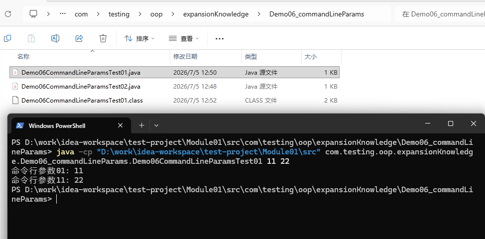

### 4.6.2 通过 idea 配置给 main 方法传参

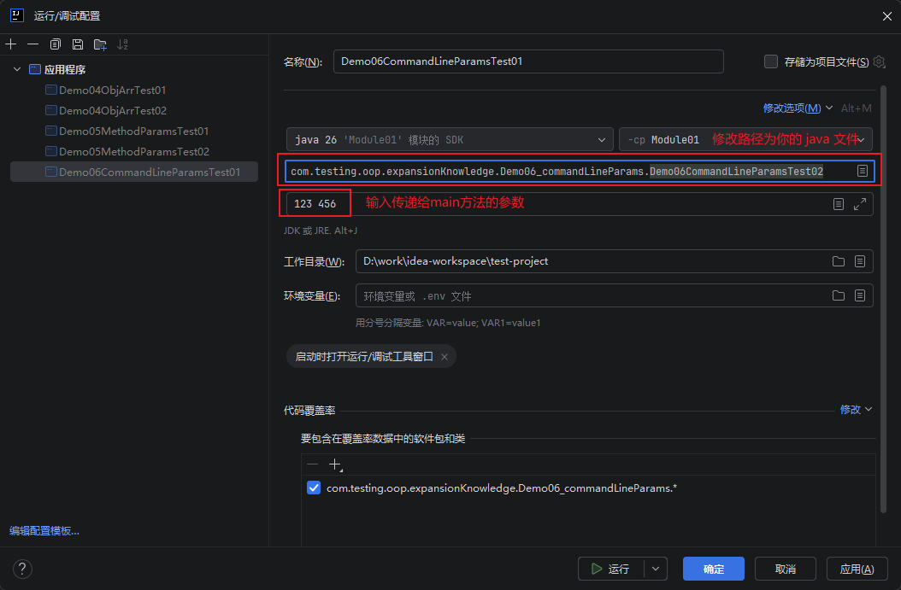

完成上面的操作之后，点击运行，就可以看到下图的运行结果了。

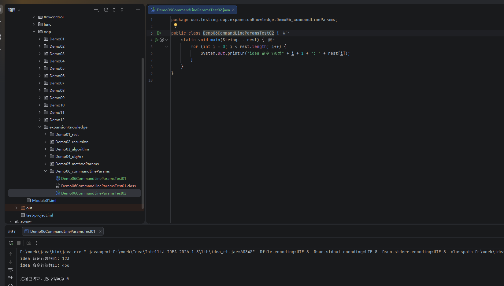

## 4.7 快速生成方法

运行

## 4.8 debug 调试操作

# 5 1-7章项目练习
