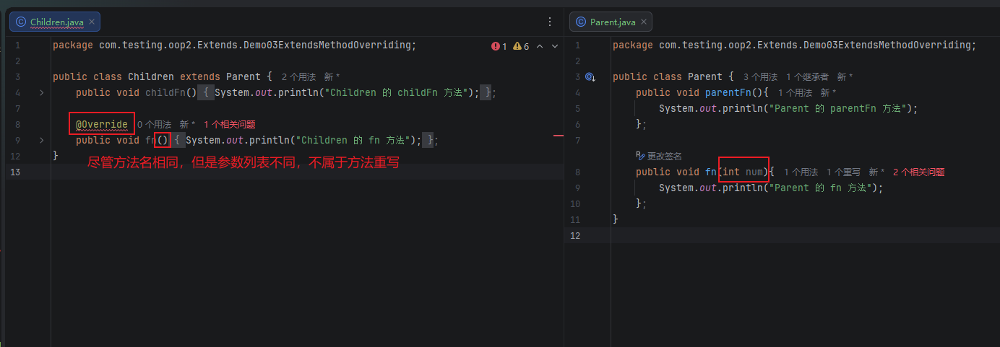
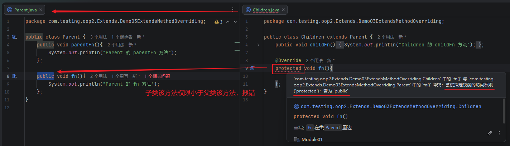
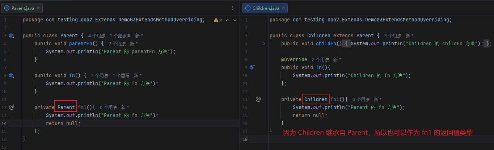
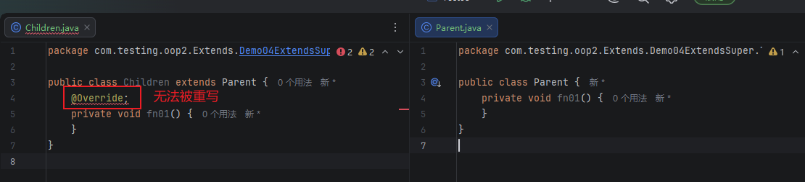
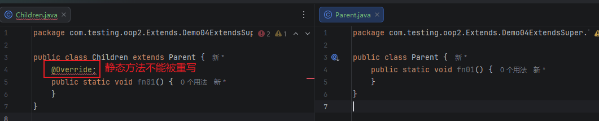
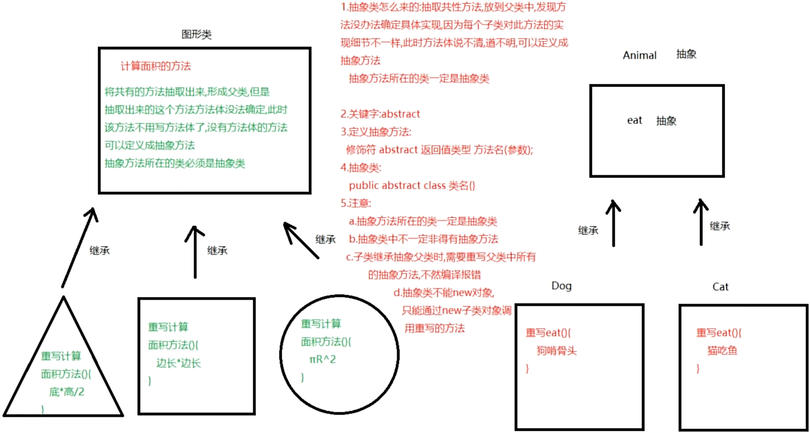
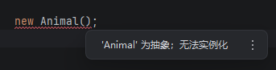
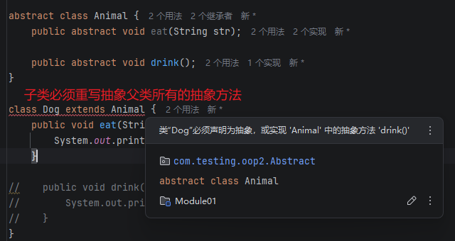
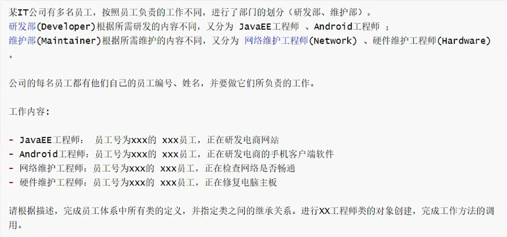

# 1 继承

当多个类有一些重复的成员变量或方法时，就可以用上继承了。可以基于这几个类抽出具有公共成员变量或方法父类，然后让这几个类去继承父类，继承之后的类都可以使用父类中的非私有成员变量和方法，这样就可以减少重复代码的书写。所以继承也可以说是代码的设计理念、设计思想。

**注意：**

- 子类可以继承父类中的私有和非私有成员，但只能使用非私有成员
- 父类的构造方法不能被继承

## 1.1 继承的使用

在 Java 中，通过 `extends` 关键字实现类的继承。

```java
package com.testing.oop2.Extends.Demo01ExtendsUse;

public class Employee {
    String name;
    int age;

    public void work() {
        System.out.println(name + "在工作");
    }

    private void eat() {
        System.out.println("吃饭");
    }
}
```

```java
package com.testing.oop2.Extends.Demo01ExtendsUse;

public class Teacher extends Employee { }
```

```java
package com.testing.oop2.Extends.Demo01ExtendsUse;

public class Manager extends Employee { }
```

```java
package com.testing.oop2.Extends.Demo01ExtendsUse;

public class Demo01ExtendsUseTest {
    public static void main(String[] args) {
        Teacher t = new Teacher();
        t.name = "老师1";
        t.age = 22;
        // t.eat(); // 父类的私有成员无法使用，会报错：'eat()' 在 'com.testing.oop2.Extends.Demo01ExtendsUse.Employee' 中具有 private 访问权限
        t.work();

        Manager m = new Manager();
        m.name = "管理者1";
        m.age = 22;
        m.work();
    }
}

/*
老师1在工作
管理者1在工作
*/
```

## 1.2 继承中 - 成员变量和方法的访问特点

在继承中，Java 的成员变量、方法的绑定机制不同。

### 成员变量

成员变量是在编译期绑定，也就是等号左边是什么类，就访问该类的变量

```java
package com.testing.oop2.Extends.Demo02ExtendsFeature;

public class Parent {
    int parentNum = 111;
    int normalNum = 123;
}
```

```java
package com.testing.oop2.Extends.Demo02ExtendsFeature;

public class Children extends Parent {
    int childNum = 222;
    int normalNum = 456;
}
```

```java
package com.testing.oop2.Extends.Demo02ExtendsFeature;

public class Demo02ExtendsFeatureTest01 {
    public static void main(String[] args) {
        Parent p = new Parent();
        System.out.println("parent-parentNum==" + p.parentNum);
        System.out.println("parent-normalNum==" + p.normalNum);

        System.out.println("------------------------");

        Children c = new Children();
        System.out.println("child-parentNum==" + c.parentNum); // Children 类没有 parentNum，就会从继承的父类上读取 parentNum;
        System.out.println("child-childNum==" + c.childNum);
        System.out.println("child-normalNum==" + c.normalNum); // Children 和 Parent 相同的属性，子类属性会覆盖父类属性

        System.out.println("------------------------");

        // 这里的 normalNum 拿到的是 Parent 这个类里面的，也就是子类继承父类，对于相同的成员变量，左边的类是哪个，该相同成员变量就取这个类里面对应的变量值
        Parent p1 = new Children();
        System.out.println("p1-normalNum==" + p1.normalNum);
    }
}

/*
parent-parentNum==111
parent-normalNum==123
------------------------
child-parentNum==111
child-childNum==222
child-normalNum==456
------------------------
p1-normalNum==123
*/
```

### 成员方法

成员方法是在运行期绑定，也就是 `new` 的是谁，就调用谁的方法。

```java
package com.testing.oop2.Extends.Demo02ExtendsFeature;

public class Parent {
    public void fn() {
        System.out.println("Parent 的 fn 方法！");
    }
}
```

```java
package com.testing.oop2.Extends.Demo02ExtendsFeature;

public class Children extends Parent {
    public void fn() {
        System.out.println("children 的 fn 方法！");
    }
}
```

```java
package com.testing.oop2.Extends.Demo02ExtendsFeature;

public class Demo02ExtendsFeatureTest02 {
    public static void main(String[] args) {
        Parent p = new Parent();
        p.fn();

        Children c = new Children();
        c.fn(); // Children 和 Parent 相同的方法，子类方法会重写父类方法

        // 这里的 fn 方法调用的是 Children 这个类里面的，子类继承父类，对于相同的方法，new 的是哪个类，就调用该类里面对应的方法，不像成员变量，看的是左边的类
        Parent p1 = new Children();
        p1.fn();
    }
}

/*
Parent 的 fn 方法！
children 的 fn 方法！
children 的 fn 方法！
*/
```

## 1.3 方法重写

在类的继承中，当子类中拥有一个和父类 **方法名以及参数列表相同** 的方式时，就可以对父类的这个方法进行重写。

对于方法的重写，new 的是哪个类，就是嗲用哪个类上的方法，当 new 的类没有该方法时，则继续往父类上寻找该方法。

```java
package com.testing.oop2.Extends.Demo03ExtendsMethodOverriding;

public class Parent {
    public void parentFn(){
        System.out.println("Parent 的 parentFn 方法");
    };

    public void fn(){
        System.out.println("Parent 的 fn 方法");
    };
}
```

```java
package com.testing.oop2.Extends.Demo03ExtendsMethodOverriding;

public class Children extends Parent {
    public void childFn(){
        System.out.println("Children 的 childFn 方法");
    };

    @Override
    public void fn(){
        System.out.println("Children 的 fn 方法");
    };
}
```

```java
package com.testing.oop2.Extends.Demo03ExtendsMethodOverriding;

public class Demo03ExtendsMethodOverridingTest01 {
    public static void main(String[] args) {
        Parent p = new Parent();
        p.parentFn();
        p.fn();

        System.out.println("-------------------------");

        Children c = new Children();
        c.parentFn(); // Children 类没有该方法，则往父类 Parent 上查找
        c.childFn();
        c.fn(); // 方法名和参数列表相同，则重写方法
    }
}

/*
Parent 的 parentFn 方法
Parent 的 fn 方法
-------------------------
Parent 的 parentFn 方法
Children 的 childFn 方法
Children 的 fn 方法
*/
```

### `@Override` 注解

通过在方法上写 `@Override`，就可以检测是否为重写方法，如果 **方法名** 或者 **参数列表** 不同，则不是重写方法，会报错，如下图：



**另外：**

### 方法重写注意事项

- 子类重写父类方法后，子类重写的方法权限必须要大于等于父类该方法的权限，权限指的是方法的访问权限，也就是方法前面的修饰符；
  `public` > `protected` > 默认（什么修饰符都不写就是默认）> `private`
  
- 子类重写的方法，方法名和参数列表要与父类该方法一致；
- **构造方法**、**静态方法**、**私有方法** 和 **final 修饰的方法** 都不能被重写：
  - **构造方法**，构造方法无法被继承，所以自然就无法重写；
  - **静态方法**，子类写父类里面存在的同名静态方法，只是 “隐藏” 了父类的静态方法，而不是重写它；
  - **私有方法**，`private` 修饰的方法只能在当前类内部可见，所以子类见不到父类的private方法，自然也就无法重写；
  - **final 修饰的方法**，是最终版本的方法，子类完全无法重写，如果重写了编译器会直接报错。
- 子类重写父类方法时，返回值类型可以缩小为父类返回值类型的子类
  

### 方法重写的使用场景

#### 场景1 修正 / 优化父类的默认实现

父类定义通用行为，子类根据自身特性重写逻辑。

```java
package com.testing.oop2.Extends.Demo03ExtendsMethodOverriding.ApplySenario1;

public class Animal {
    public void makeSound(){};
}
```

```java
package com.testing.oop2.Extends.Demo03ExtendsMethodOverriding.ApplySenario1;

public class Dog extends Animal {
    // 子类重写 makeSound 方法，实现狗叫
    @Override
    public void makeSound() {
        System.out.println("汪汪汪");
    }
}
```

```java
package com.testing.oop2.Extends.Demo03ExtendsMethodOverriding.ApplySenario1;

public class Cat extends Animal {
    // 子类重写 makeSound 方法，实现狗叫
    @Override
    public void makeSound() {
        System.out.println("喵喵喵");
    }
}
```

```java
package com.testing.oop2.Extends.Demo03ExtendsMethodOverriding.ApplySenario1;

public class ApplySenario1 {
    public static void main(String[] args) {
        Animal a1 = new Dog();
        a1.makeSound(); // 输出：汪汪汪

        Animal a2 = new Cat();
        a2.makeSound(); // 输出：喵喵喵
    }
}

/*
汪汪汪
喵喵喵
*/
```

#### 场景2 扩展父类功能，保留原有逻辑

子类需要在父类方法的基础上增加新功能，而不是完全替换，这时可以用 `super.父类方法()` 调用父类逻辑，再添加自己的代码。

```java
package com.testing.oop2.Extends.Demo03ExtendsMethodOverriding.ApplySenario2;

public class Employee {
    public void work() {
        System.out.println("员工开始工作");
    }
}
```

```java
package com.testing.oop2.Extends.Demo03ExtendsMethodOverriding.ApplySenario2;

public class Manager extends Employee {
    @Override
    public void work() {
        // 先调用父类原有逻辑
        super.work();
        // 子类扩展：增加管理日志
        System.out.println("经理额外：分配任务、审批流程");
    }
}
```

```java
package com.testing.oop2.Extends.Demo03ExtendsMethodOverriding.ApplySenario2;

public class ApplySenario2 {
    public static void main(String[] args) {
        Employee e = new Employee();
        e.work();

        System.out.println("------------------------");

        Manager m = new Manager();
        m.work();
    }
}

/*
员工开始工作
------------------------
员工开始工作
经理额外：分配任务、审批流程
*/
```

## 1.4 继承中构造方法的特点

在 new 子类对象时，会先初始化父类，也就是先执行父类的构造方法，再执行子类的构造方法。

原因是如果一个子类是继承类，则该子类的构造方法的第一行，默认会调用 `super()` 方法，即使你不写，jvm 也会自动提供一个。而 `super()` 就代表父类的构造函数。

```java
package com.testing.oop2.Extends.Demo04ExtendsSuper.Test01;

public class Parent {
    public Parent() {
        System.out.println("Parent 类的无参构造");
    }

    public Parent(int num) {
        System.out.println("Parent 类的有参构造" + num);
    }
}
```

```java
package com.testing.oop2.Extends.Demo04ExtendsSuper.Test01;

public class Children extends Parent {
    public Children() {
        // 在代码块的第一行，jvm 默认提供和调用 super() 方法
        System.out.println("Children 类的无参构造");
    }

    public Children(int num) {
        super(num);
        System.out.println("Children 类的有参构造" + num);
    }
}
```

```java
package com.testing.oop2.Extends.Demo04ExtendsSuper.Test01;

public class Test01 {
    public static void main(String[] args) {
        new Children();

        System.out.println("--------------------------");

        new Children(100);
    }
}

/*
Parent 类的无参构造
Children 类的无参构造
--------------------------
Parent 类的有参构造100
Children 类的有参构造100
*/
```

### 1.4.1 super 关键字的使用

`super` 代表父类的引用（对象级），可以用来调用**父类的构造函数**和**访问父类的实例成员（成员变量、成员方法）**，super 也可以访问静态成员，但 super 是对象层级，不建议直接通过 super 来访问静态成员，还是建议用类名方式访问静态成员。

`super` 的具体使用：

- 调用父类构造方法，可以通过在子类构造函数中写：`super()` 调用父类的无参构造方法，或者 `super(实参)` 调用父类的有参构造方法；
- 调用父类的成员变量，通过 `super.成员变量名` 即可使用；
- 调用父类的成员方法，通过 `super.成员方法(实参)` 即可使用。

```java
package com.testing.oop2.Extends.Demo04ExtendsSuper.Test02;

public class Parent {
    String name = "Parent class";

    public Parent() {
        System.out.println("Parent 的无参构造方法");
    }

    public Parent(int num) {
        System.out.println("Parent 的有参构造方法" + num);
    }

    public void fn() {
        System.out.println("Parent 的 fn 方法");
    }
}
```

```java
package com.testing.oop2.Extends.Demo04ExtendsSuper.Test02;

public class Children extends Parent {
    String name = "Children class";

    public Children() {
        super();
        System.out.println("Children 的无参构造方法");
    }

    public Children(int num) {
        super(num);
        System.out.println("Children 的有参构造方法" + num);
    }

    public void fn() {
        System.out.println("Children 的 fn 方法");
        super.fn(); // 调用父类的成员方法
        String allName = "Children 的 name==" + name + "，Parent 的 name==" + super.name; // 调用父类的成员属性
        System.out.println(allName);
    }
}
```

```java
package com.testing.oop2.Extends.Demo04ExtendsSuper.Test02;

public class Test02 {
    public static void main(String[] args) {
        Children c1 = new Children();
        System.out.println("-----------------------");
        Children c2 = new Children(123);
        System.out.println("-----------------------");
        c2.fn();
    }
}

/*
Parent 的无参构造方法
Children 的无参构造方法
-----------------------
Parent 的有参构造方法123
Children 的有参构造方法123
-----------------------
Children 的 fn 方法
Parent 的 fn 方法
Children 的 name==Children class，Parent 的 name==Parent class
*/
```

### 1.4.2 this 关键字的使用

`this` 代表当前的实例对象，主要是为了区别跟成员变量重名的局部变量，以及调用当前对象中的成员（变量和方法）。

`this` 的具体使用：

- 通过 `this()` 可调用无参构造函数， `this(实参)` 可调用有参构造函数；
- `this.成员变量名` 可调用当前对象的成员变量；
- `this.成员方法(实参)` 可调用当前对象的成员方法。

```java
package com.testing.oop2.Extends.Demo04ExtendsSuper.Test03;

public class Children1 {
    public Children1() {
        this("abc123"); // 在无参构造函数中调用有参构造函数
        System.out.println("Children1 的无参构造方法");
    }

    public Children1(String name) {
        System.out.println("Children1 的有参构造方法：" + name);
    }
}
```

```java
package com.testing.oop2.Extends.Demo04ExtendsSuper.Test03;

public class Children2 {
    String name = "Children2 class";

    public Children2() {
        System.out.println("Children2 的无参构造方法");
    }

    public Children2(String name) {
         this(); // 在有参构造函数中调用无参构造函数
        System.out.println("Children2 的有参构造方法：" + name);
    }

    public void fn(String name) {
        System.out.println("fn 方法");
        System.out.println("局部变量 name 为：" + name + "，成员变量 name 为：" + this.name);
        this.fn01();
    }

    public void fn01(){
        System.out.println("fn1 方法");
    }
}
```

```java
package com.testing.oop2.Extends.Demo04ExtendsSuper.Test03;

public class Test03 {
    public static void main(String[] args) {
        new Children1();
        System.out.println("--------------");
        Children2 c2 = new Children2("bcd456");
        c2.fn("112233");
    }
}

/*
Children1 的有参构造方法：abc123
Children1 的无参构造方法
--------------
Children2 的无参构造方法
Children2 的有参构造方法：bcd456
fn 方法
局部变量 name 为：112233，成员变量 name 为：Children2 class
fn1 方法
*/
```

### 1.4.3 super 和 this 注意事项

`super` 和 `this` 在构造函数中使用，都必须写在第一行，所以两者无法同时存在。

### 1.4.4 继承的特点

- 子类继承只支持继承单个父类，不支持继承多个父类；
  ```java
  public class A extends B, C {} // 这个是错误的
  ```
- 子类继承支持多个继承；
  ```java
  public class A extends B {}
  public class B extends C {}
  ```
- 一个父类可以有多个子类继承；
  ```java
  public class A extends C {}
  public class B extends C {}
  ```
- **构造方法** 不能被继承，也不能被重写；
- **私有方法** 不能被继承，但不能被重写；
  
- **静态方法** 可以被继承，但也不能重写
  

  ```java
  package com.testing.oop2.Extends.Demo04ExtendsSuper;
  
  public class Test04 {
      public static void main(String[] args) {
          Children c = new Children();
          c.fn01(); // fn01 看着是被继承了，其实编译成 class 文件之后，是通过 Children.fn01 的方式调用的
      }
  }
  
  class Parent {
      public static void fn01() {
          System.out.println("Parent 静态方法 fn01");
      }
  }
  
  class Children extends Parent {}
  
  /*
  Parent 静态方法 fn01
  */
  ```

### 1.4.5 为父类私有属性赋值

下面两个案例共用一个公共父类 `Employee`

```java
package com.testing.oop2.Extends.Demo04ExtendsSuper.Test05;

public class Employee {
    private String name;
    private int age;

    public Employee() {
    }

    public Employee(String name, int age) {
        this.name = name;
        this.age = age;
    }

    public String getName() {
        return name;
    }

    public void setName(String name) {
        this.name = name;
    }

    public int getAge() {
        return age;
    }

    public void setAge(int age) {
        this.age = age;
    }
}
```

#### 1.4.5.1 通过 `set` 方法赋值

```java
package com.testing.oop2.Extends.Demo04ExtendsSuper.Test05;

public class Teacher extends Employee{ }
```

```java
package com.testing.oop2.Extends.Demo04ExtendsSuper.Test05;

public class Test05 {
    public static void main(String[] args) {
        Teacher t = new Teacher();
        t.setName("老大");
        t.setAge(20);
        System.out.println("通过继承的父类的 set 方法为父类私有属性赋值：name==" + t.getName() + "，age==" + t.getAge());
    }
}

/*
通过继承的父类的 set 方法为父类私有属性赋值：name==老大，age==20
*/
```

#### 1.4.5.2 通过构造方法赋值

```java
package com.testing.oop2.Extends.Demo04ExtendsSuper.Test05;

public class Manager extends Employee {
    public Manager (String name, int age) {
        super(name, age);
    }
}
```

```java
package com.testing.oop2.Extends.Demo04ExtendsSuper.Test05;

public class Test05 {
    public static void main(String[] args) {
        Manager m = new Manager("老二", 18);
        System.out.println("通过子类构造方法为父类私有属性赋值：name==" + m.getName() + "，age==" + m.getAge());
    }
}

/*
通过子类构造方法为父类私有属性赋值：name==老二，age==18
*/
```

# 2 抽象



当父类中的方法没办法具体实现，需要依托子类继承之后再实现细节时，就可以用上抽象特性。

通过 `abstract` 关键字就可以给方法和类加上抽象特性，使用格式如下：

```java
public abstract class 类名 {
    修饰符 abstract 返回值类型 方法名(参数)
}
```

抽象类可以看成是一类事物的标准，只要属于这一类事物，都必须拥有抽象类中的方法，然后根据细节来重写相应的抽象方法。

```java
package com.testing.oop2.Abstract;

public class Demo01 {
    public static void main(String[] args) {
        Dog d = new Dog();
        d.eat("狗粮");
        d.drink();

        Cat c = new Cat();
        c.eat("猫粮");
        c.drink();
    }
}

abstract class Animal {
    public abstract void eat(String str);

    public abstract void drink();
}

class Dog extends Animal {
    public void eat(String str) {
        System.out.println("狗吃" + str);
    }

    public void drink() {
        System.out.println("狗喝水");
    }
}

class Cat extends Animal {
    public void eat(String str) {
        System.out.println("猫吃" + str);
    }

    public void drink() {
        System.out.println("猫喝水");
    }
}
```

## 2.1 抽象类和方法注意事项

- 抽象方法所在的类一定是抽象类，抽象类可以有抽象方法，也可以没有抽象方法；

  ```java
  public abstract class Animal {
    public abstract void eat(String food); // 可以有抽象方法
  }

  // 也可以没有抽象方法
  public abstract class Animal { }
  ```

- 抽象类不能 new 对象，只能通过 new 子类对象调用重写的抽象方法
  
- 非抽象子类继承抽象父类后，需要重写抽象父类所有的抽象方法
  
- 抽象类可以有构造方法（供子类创建对象时，初始化父类成员属性用的）、成员变量和成员方法

  ```java
  package com.testing.oop2.Abstract;
  
  public class Demo02 {
    public static void main(String[] args) {
        Teacher t1 = new Teacher("火影");
        t1.work();
  
        Teacher t2 = new Teacher();
        t2.setName("水影");
        t2.work();
    }
  }
  
  abstract class Employee {
    private String name;
  
    public Employee() { }
  
    public Employee(String name) {
        this.name = name;
    }
  
    public String getName() {
        return name;
    }
  
    public void setName(String name) {
        this.name = name;
    }
  
    public abstract void work();
  }
  
  class Teacher extends Employee {
    public Teacher() { }
  
    public Teacher(String name) {
        super(name);
    }
  
    public void work() {
        System.out.println(this.getName() + "老师在上课");
    }
  }
  
  /*
  火影老师在上课
  水影老师在上课
  */
  ```

## 2.2 综合案例



```java
package com.testing.oop2.Abstract.Demo03;

public abstract class Employee {
    private int id;
    private String name;

    public Employee() { }

    public Employee(int id, String name) {
        this.id = id;
        this.name = name;
    }

    public int getId() {
        return id;
    }

    public void setId(int id) {
        this.id = id;
    }

    public String getName() {
        return name;
    }

    public void setName(String name) {
        this.name = name;
    }

    public abstract void work(int id, String name);
}
```

```java
package com.testing.oop2.Abstract.Demo03;

public abstract class Developer extends Employee {
    public Developer() { }

    public Developer(int id, String name) {
        super(id, name);
    }
}
```

```java
package com.testing.oop2.Abstract.Demo03;

public class JavaeeEngineer extends Developer {
    public JavaeeEngineer() { }

    public JavaeeEngineer(int id, String name) {
        super(id, name);
    }

    public void work(int id, String name){
        System.out.println("员工号为 " + this.getId() + " 的 " + this.getName() + " 员工，正在研发电脑");
    }
}
```

```java
package com.testing.oop2.Abstract.Demo03;

public class AndroidEngineer extends Developer {
    public AndroidEngineer() { }

    public AndroidEngineer(int id, String name) {
        super(id, name);
    }

    public void work(int id, String name) {
        System.out.println("员工号为 " + id + " 的 " + name + " 员工，正在研发电商的手机客户端软件");
    }
}
```

```java
package com.testing.oop2.Abstract.Demo03;

public abstract class Maintainer extends Employee {
    public Maintainer() { }

    public Maintainer(int id, String name) {
        super(id, name);
    }
}
```

```java
package com.testing.oop2.Abstract.Demo03;

public class NetworkEngineer extends Maintainer {
    public NetworkEngineer() { }

    public NetworkEngineer(int id, String name) {
        super(id, name);
    }

    public void work(int id, String name) {
        System.out.println("员工号为 " + id + " 的 " + name + " 员工，正在检查网络是否通畅");
    }
}
```

```java
package com.testing.oop2.Abstract.Demo03;

public class HardwareEngineer extends Maintainer {
    public HardwareEngineer() { }

    public HardwareEngineer(int id, String name) {
        super(id, name);
    }

    public void work(int id, String name){
        System.out.println("员工号为 " + this.getId() + " 的 " + this.getName() + " 员工，正在修复电脑主板");
    }
}
```

```java
package com.testing.oop2.Abstract.Demo03;

public class Demo03 {
    public static void main(String[] args) {
        JavaeeEngineer je = new JavaeeEngineer(1, "java开发");
        je.work(1, "java开发"); // 内部是 get 方法

        AndroidEngineer ae = new AndroidEngineer(2, "安卓开发");
        ae.work(2, "安卓开发"); // 方法传参

        NetworkEngineer ne = new NetworkEngineer(3, "网络开发");
        ne.work(3, "网络开发");

        HardwareEngineer he = new HardwareEngineer(4, "硬件开发");
        he.work(4, "硬件开发");
    }
}

/*
员工号为 1 的 java开发 员工，正在研发电脑
员工号为 2 的 安卓开发 员工，正在研发电商的手机客户端软件
员工号为 3 的 网络开发 员工，正在检查网络是否通畅
员工号为 4 的 硬件开发 员工，正在修复电脑主板
*/
```
